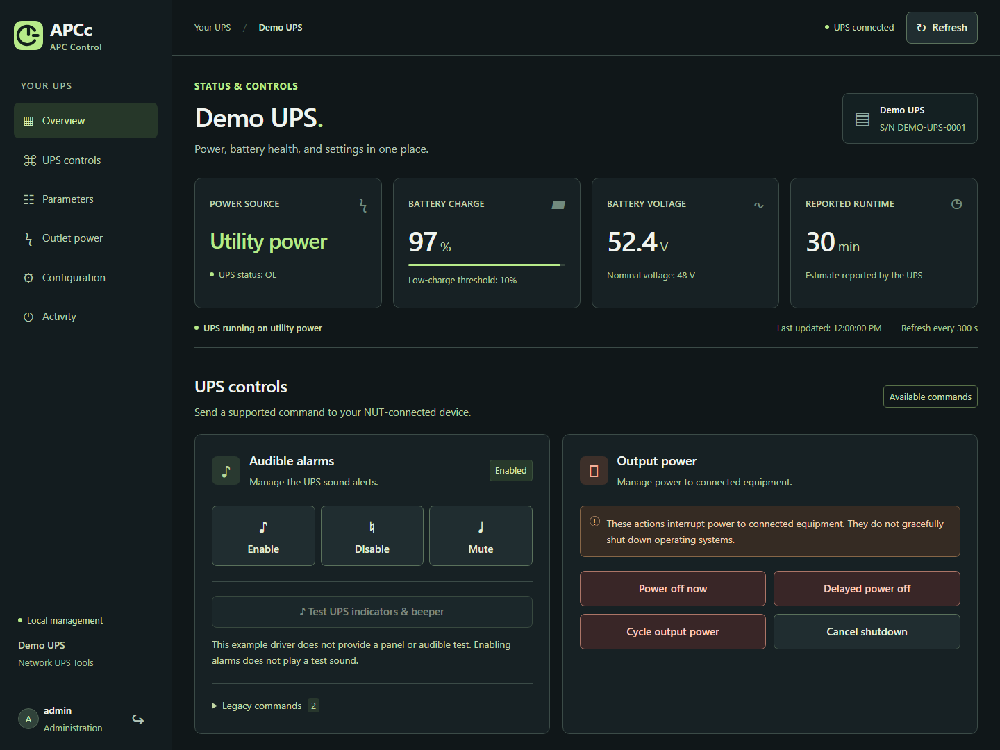
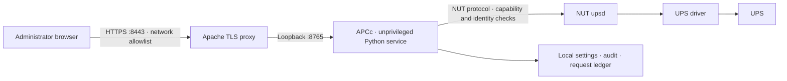

<p align="center">
  
</p>
<h1 align="center">APCc · APC Control</h1>
<p align="center"><strong>Know your power. Control it deliberately.</strong></p>
<p align="center">A local UPS control dashboard built on Network UPS Tools.</p>
<p align="center"><a href="#install">Install</a> · <a href="docs/operations.md">Operations</a> · <a href="docs/architecture.md">Architecture</a> · <a href="SECURITY.md">Security</a></p>


APCc brings UPS status, supported controls, configuration, and outlet planning into one English-language interface. It runs on your Linux host, talks directly to your NUT server, and keeps application data on that host. No cloud account or hosted frontend is required.

Built for administrators who need to know what a command will do—and what their hardware cannot report. APCc checks driver capabilities and the configured UPS identity before dispatching a command. An accepted command is reported as accepted by NUT; it is not presented as proof that the hardware completed it.

**Version 3.0.0 · Linux distribution · Python standard library · MIT license**

## What you can do

| Area | Capability |
| --- | --- |
| Live status | Battery charge, runtime, voltage, state, and available NUT power readings. |
| UPS controls | Supported alarm controls, output shutdown, delayed shutdown, output power cycle, and shutdown cancellation. |
| Operating thresholds | Edit the supported low-battery charge, low-runtime, and shutdown-delay settings. |
| Configuration | Manage display metadata, the NUT endpoint, credentials, identity matching, and refresh interval. |
| Outlet planning | Record connected devices and estimated watts; keep estimated totals separate from measured UPS power. |
| Operator account | Generated installation password, password changes, session invalidation, and login throttling. |
| Activity | Local audit records and a persistent request ledger to guard against replaying hardware commands. |

Availability depends on the UPS, connection, and NUT driver. The interface disables unavailable actions. See the [capability boundaries](docs/operations.md#capability-boundaries) before using power controls.

## Interface preview



The dashboard above uses a fictional **Demo UPS**. All screenshot values, identities,
inventory labels, and addresses are synthetic. [View the outlet inventory](docs/assets/outlets.png)
or the [mobile layout](docs/assets/mobile.png).

[Logo, artwork, and design notes](docs/brand-assets.md) are included with the source.

## Install

Use a Debian, Ubuntu, or Linux Mint host with **systemd, Python 3.10+, and a working local NUT installation**. APCc does not configure the USB driver or replace `upsmon`. The installer installs missing Python, Apache, and OpenSSL packages through `apt`.

1. Download and extract the Linux archive from this repository's **Releases** page, or clone the repository.
2. Verify the UPS is already readable. Replace `apc` with its NUT name:

   ```bash
   upsc apc@127.0.0.1
   ```

3. From the directory containing `install.sh`, run:

   ```bash
   sudo env APCC_UPS=apc bash install.sh
   ```

4. Open **https://localhost:8443/** on the host. Compare the self-signed certificate fingerprint with the installer output. Sign in as `admin` using the random password printed **once** at installation. Store it securely; there is no shared default password.

Access is restricted to loopback by default. For management-network access, set an explicit allowlist:

```bash
# Documentation network only: replace it with your actual management CIDR.
sudo env APCC_UPS=apc APCC_ALLOWED_CIDR='192.0.2.0/24' bash install.sh
```

Space- or comma-separated IPv4/IPv6 networks are accepted. Loopback remains allowed. An ordinary reinstall preserves your credentials, saved settings, and existing allowlist. The HTTPS listener uses port `8443`; the Python backend listens only on `127.0.0.1:8765`.

The installer checks the UPS serial reported by NUT, creates a dedicated unprivileged `apcc` service account, and adds a managed `apcc` NUT account. It reloads `upsd` to apply that account without restarting the UPS driver or executing a hardware command. Read the [installation and recovery details](docs/operations.md) for an existing Apache installation or a changed UPS.

## How it fits together



The frontend has no external font, analytics, or CDN dependency. The backend uses Python's standard library. Apache terminates HTTPS and supplies the trusted client-address headers; NUT remains responsible for communicating with the hardware. [Read the architecture](docs/architecture.md).

## Operational boundaries

- **Power commands can interrupt attached equipment.** They do not perform a graceful operating-system shutdown. Configure and test NUT's shutdown coordination separately.
- **A beeper enable command does not produce a test tone.** The panel test is available only when the driver advertises `test.panel.start`; it can also exercise front-panel indicators.
- **Outlet estimates are planning data.** APCc does not manufacture per-outlet measurements or individual outlet switching from aggregate UPS telemetry.
- **Firmware updates and SmartConnect provisioning are outside this application.** Use the manufacturer-supported workflow for your hardware.
- **Inventory fields do not reconfigure hardware.** Editing a model label or inventory IP changes APCc metadata, not the UPS network configuration.

## Development

```bash
python3 -m unittest discover -s tests -v
python3 -m py_compile app.py
bash -n install.sh
python3 scripts/check_public.py
```

Tests use synthetic identities and a fake NUT service. They must not send commands to a real UPS. CI runs the unit suite across Python 3.10–3.13. See [contribution guidance](CONTRIBUTING.md) and the [security policy](SECURITY.md).

Screenshots and public examples contain synthetic demonstration data. Runtime configurations, certificates, credentials, audit logs, and device identities belong outside the repository.

APCc is an independent project. It is not affiliated with, endorsed by, or supported by APC or Schneider Electric. Their names and trademarks belong to their respective owners. The APCc logo is an original project mark.
